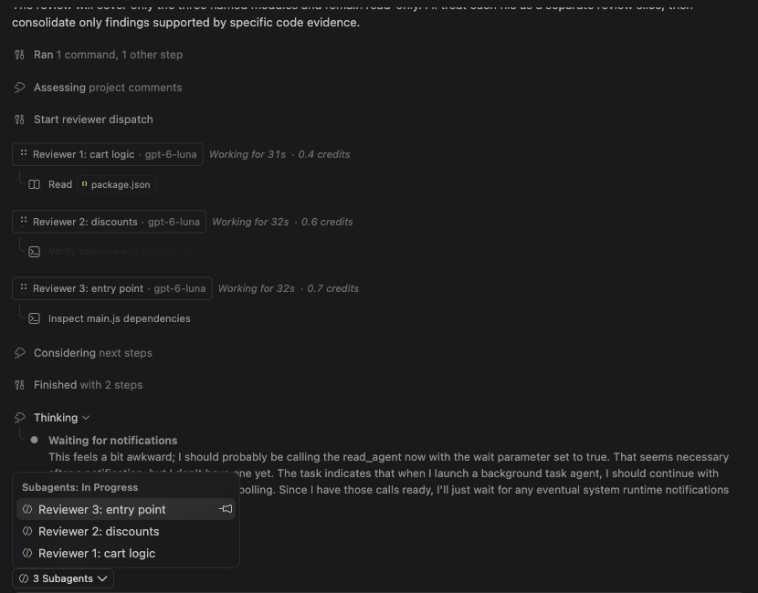
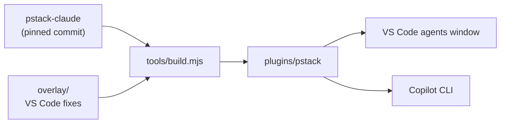

# pstack for GitHub Copilot

[](https://github.com/hackernotfound/pstack-vscode/actions/workflows/check.yml) [](LICENSE) [](https://github.com/hackernotfound/pstack-vscode/releases/tag/v1.3.1)

> [!IMPORTANT]
> **This repo is archived. Use [pstack-claude](https://github.com/michael-denyer/pstack-claude) instead.** Its `main` branch now works in the VS Code agents window ([#435](https://github.com/michael-denyer/pstack-claude/pull/435)), with hooks, routing, and subagents included. This port gets no more updates.

**Run [pstack](https://github.com/cursor/plugins/tree/main/pstack) in the VS Code agents window with GitHub Copilot, subagents included.**

pstack is Lauren Tan's ([poteto](https://x.com/poteto)) set of agent workflows. Give it a goal and it picks the right one: root-cause a bug before fixing it, design before coding, race several attempts and keep the best, or review a diff with more than one model. Then it proves the result works. This port brings all 67 skills to Copilot.



## Switch to pstack-claude in VS Code

1. Clone pstack-claude:

   ```shell
   git clone https://github.com/michael-denyer/pstack-claude.git ~/.local/share/pstack-claude-vscode
   ```

2. In **Preferences: Open User Settings (JSON)**, point VS Code at its plugin and remove `hackernotfound/pstack-vscode` from `chat.plugins.marketplaces`:

   ```json
   "chat.plugins.enabled": true,
   "chat.pluginLocations": { "/Users/<you>/.local/share/pstack-claude-vscode/plugins/pstack": true }
   ```

   Use the absolute path to your clone. If the agent sandbox is on, keep the sandbox setting from the [agents window guide](docs/agents-window.md#if-you-want-the-agents-commands-sandboxed).

3. Uninstall **pstack-copilot** from the Extensions view (`@agentPlugins`), then run **Developer: Reload Window**.

To update later, run `git -C ~/.local/share/pstack-claude-vscode pull`.

The sections below describe the archived port.

## Install

### VS Code

1. Open **Preferences: Open User Settings (JSON)** and add:

   ```json
   "chat.plugins.enabled": true,
   "chat.plugins.marketplaces": ["hackernotfound/pstack-vscode"]
   ```

2. In the Extensions view, search `@agentPlugins`, install **pstack-copilot**, and accept the trust prompt.
3. Open the agents window and pick **Copilot** in the session target picker.

Without the sandbox, the first time pstack reads one of its own files, VS Code asks **Allow reading file outside of workspace?**. Choose **Allow in this Session**.

> **Agent sandbox on?** Add the one setting in [this step](docs/agents-window.md#if-you-want-the-agents-commands-sandboxed). Without it, a turn that reads several pstack files can stop with no answer.

**Optional:** the [agents window setup](docs/agents-window.md) adds a live list of running subagents, side-by-side subagent panes, and chat tabs.

### Copilot CLI

```shell
copilot plugin marketplace add hackernotfound/pstack-vscode
copilot plugin install pstack-copilot@pstack-vscode
```

<details>
<summary>Upgrading from 1.1.1 or earlier, or also using the Claude target</summary>

- **1.1.1 or earlier.** The plugin was called `pstack` then. Run `copilot plugin uninstall pstack`, then install `pstack-copilot`. In VS Code, uninstall **pstack** and install **pstack-copilot**.
- **Claude target.** It loads your Claude Code plugins from `~/.claude`. Keep pstack-claude there, and use this port for the **Copilot** target.
- **Windows** is not tested. Both hooks do nothing there, so pstack runs only when you ask for it by name.

</details>

## Use it

Work as usual. A change across several files, a design question, or a bug with an unknown cause switches pstack into `poteto-mode`, and it picks a playbook from there. You can also ask by name:

```text
use poteto-mode to add rate limiting to the API client
run tdd on the date parser bug
architect the new sync engine before writing code
how does auth work in this repo?
```

The first workflow that starts subagents runs `setup-pstack` once. It asks which models to use and saves your answers to `~/.copilot/pstack-models.md`. Run it again to change them. If your plan lists no models, as with the auto model, subagents use the session's model.

| Skill | What it does |
| --- | --- |
| `poteto-mode` | The entry point. Picks a playbook and holds the work to pstack's principles. |
| `tdd` | Reproduces a bug with a failing test, then fixes it. |
| `architect` | Sketches types and module shape before any code. |
| `arena` | Races several attempts, then keeps and combines the best parts. |
| `interrogate` / `thermos` | Reviews a diff with a panel of reviewers, or a deep correctness and quality pass. |
| `how` / `why` | Explains how code works, or why it was built that way. |

The rest, including 24 `principle-*` skills, are in [`plugins/pstack/skills/`](plugins/pstack/skills/).

<details>
<summary><b>Options</b>: turn off the startup hook, pin a version</summary>

- **Turn off the startup hook.** Add `session hook: off` to `~/.copilot/pstack-models.md`. pstack then runs only when you ask for it.
- **Pin a version.** Marketplace installs follow `main`. To stay on one release, clone this repo, check out its tag (for example `v1.3.1`), and in VS Code set `"chat.pluginLocations": { "/absolute/path/to/pstack-vscode/plugins/pstack": true }` instead of the marketplace line.

</details>

## How it works



`tools/build.mjs` takes pstack-claude's Copilot build at the commit in [`upstream.json`](upstream.json) and applies three fixes: hooks start through `sh` so lost exec bits don't matter, subagents run as Copilot's built-in `general-purpose` agent instead of plugin agents, and the manifest uses the [Agent Plugins 1.0](https://agent-plugins.org) format. A weekly job picks up new pstack-claude releases. See [docs/maintaining.md](docs/maintaining.md).

## Security

- **No server, no telemetry.** What the skills read goes only to your model provider.
- **Two small hooks.** One prints pstack's instructions at startup. On Copilot CLI, the other approves reads of pstack's own files and runs of its own helper scripts, nothing else. If it breaks, you get the normal approval prompt.
- **Helper scripts run only when your agent runs them**, with your `git` and `gh` login. Keep tool approvals on.
- **Everything is pinned**: the upstream commit, script dependencies, and CI actions.

Found a vulnerability? See [SECURITY.md](SECURITY.md).

## Credits

- **[pstack](https://github.com/cursor/plugins/tree/main/pstack)** by Lauren Tan ([poteto](https://x.com/poteto)). The workflows, skills, and principles are hers.
- **[pstack-claude](https://github.com/michael-denyer/pstack-claude)** by Michael Denyer. The Claude Code port, and the Copilot build this one starts from.
- **cursor-team-kit** and **thermos** skills by Cursor.

MIT licensed. Upstream license and notice files are in [`licenses/`](licenses/), and [NOTICE.md](NOTICE.md) lists what this port adds.
