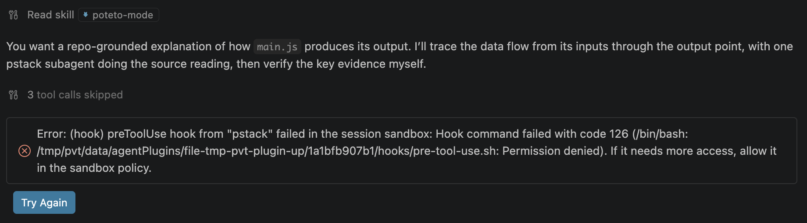
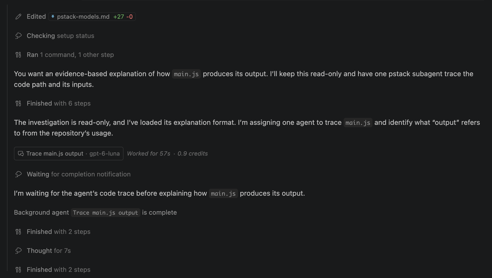
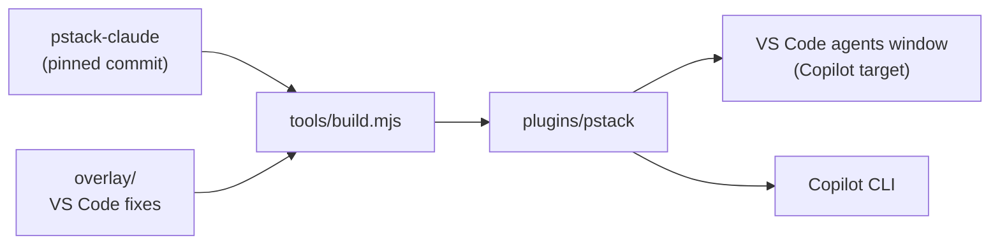

# pstack for GitHub Copilot

[](https://github.com/hackernotfound/pstack-vscode/actions/workflows/check.yml) [](LICENSE) [](https://github.com/hackernotfound/pstack-vscode/releases/tag/v1.3.0)

**Run [pstack](https://github.com/cursor/plugins/tree/main/pstack) in the VS Code agents window with GitHub Copilot, subagents included.**

pstack is Lauren Tan's ([poteto](https://x.com/poteto)) set of agent workflows. Tell it a goal and it picks the right one: root-cause a bug before fixing it, sketch a design before coding it, race several attempts and keep the best, review a diff with more than one model. Then it proves the result works. This port brings all 67 of its skills to Copilot.

[Why this port](#why-this-port) · [Install](#install) · [Use it](#use-it) · [Agents window setup](docs/agents-window.md) · [What you get](#what-you-get) · [How it works](#how-it-works) · [Security](#security) · [Credits](#credits)

## Why this port

[pstack-claude](https://github.com/michael-denyer/pstack-claude), Michael Denyer's port, has its own Copilot build. On Copilot CLI it works well, and this port builds on it. In the VS Code agents window it breaks.

| In the VS Code agents window | pstack-claude 0.9.133 | pstack-copilot 1.3.0 |
| --- | --- | --- |
| pstack switches on at session start | No. VS Code's copy of the plugin can lose its exec bits, and the hook then fails | Yes |
| The agent can read files and run commands | No. The failing hook makes VS Code skip each call | Yes |
| pstack hands work to subagents | No. VS Code rejects `pstack:poteto-agent` as an unknown agent type | Yes, with each subagent shown in the chat |

**pstack-claude 0.9.133** in the agents window:



**pstack-copilot 1.3.0**, same window and same request:



Both were captured on VS Code 1.140.0 with the Copilot target and the auto model. Using only Copilot CLI or the Copilot app? Either build works there.

## Install

### VS Code

1. Open **Preferences: Open User Settings (JSON)** and add:

   ```json
   "chat.plugins.enabled": true,
   "chat.plugins.marketplaces": ["hackernotfound/pstack-vscode"]
   ```

2. In the Extensions view, search `@agentPlugins`, install **pstack-copilot**, and accept the trust prompt.
3. Open the agents window and pick **Copilot** in the session target picker.

If you turned on the agent sandbox (`chat.agent.sandbox.enabled`), add this setting once as well. Without it, VS Code asks to approve every read of a pstack playbook, and a turn that reads several at once can stop with no answer.

```json
"chat.agent.sandbox.fileSystem.userConfiguredPaths": {
  "readonlyPaths": ["/Users/YOU/Library/Application Support/Code/agentPlugins"],
  "readwritePaths": ["/Users/YOU/.copilot/pstack-models.md"]
}
```

Replace `/Users/YOU` with your home folder. Use full paths, because VS Code does not expand `~` here. The first path is the folder where VS Code keeps a copy of every agent plugin, and the grant is read-only. The second is the file where pstack saves your model choices. VS Code runs each agent plugin from its own copy in that folder, including a version you pin. On Linux the folder is `agentPlugins` inside VS Code's user data folder, and the first approval prompt shows its full path.

Without the sandbox, the first read of a pstack file in a session asks **Allow reading file outside of workspace?**. Choose **Allow in this Session**.

**Windows** is not tested. Both hooks do nothing there, so pstack runs when you ask for it by name, and every tool call goes through VS Code's normal approval.

**Want to see your subagents while they run?** Follow the one-time [agents window setup](docs/agents-window.md). It adds a live list of running subagents, side-by-side subagent panes, and chat tabs, close to [T3 Code](https://t3.codes).


### Copilot CLI

```shell
copilot plugin marketplace add hackernotfound/pstack-vscode
copilot plugin install pstack-copilot@pstack-vscode
```

> **Installed 1.1.1 or earlier?** The plugin was called `pstack` then. Run `copilot plugin uninstall pstack`, then install `pstack-copilot` as above. In VS Code, uninstall **pstack** and install **pstack-copilot**.

> **Using the Claude target too?** The Claude target loads your Claude Code plugins from `~/.claude`. Keep pstack-claude for that target, and use this port for **Copilot**.

## Use it

Just work as usual. A change that touches more than one file, a design question, or a bug with an unknown cause switches pstack into `poteto-mode` on its own, and it picks the matching playbook from there.

To start a workflow yourself, ask for it by name:

```text
use poteto-mode to add rate limiting to the API client
run tdd on the date parser bug
architect the new sync engine before writing code
how does auth work in this repo?
```

**First run.** The first workflow that starts subagents runs `setup-pstack` once. It asks a few quick questions and saves your answers to `~/.copilot/pstack-models.md`. If VS Code lists no models for your plan, as with the auto model, every subagent runs on the session's model.

<details>
<summary><b>Options</b>: turn off the startup hook, change models, pin a version</summary>

- **Turn off the startup hook.** Add `session hook: off` to `~/.copilot/pstack-models.md`. pstack then runs only when you ask for it.
- **Change models.** Run `setup-pstack` again. It lists the models your account offers and saves only the ones you pick.
- **Pin a version.** Marketplace installs follow `main`. To stay on one release, clone this repo, check out its tag (for example `v1.3.0`), and in VS Code set `"chat.pluginLocations": { "/absolute/path/to/pstack-vscode/plugins/pstack": true }` instead of the marketplace line.

</details>

## What you get

| Skill | What it does |
| --- | --- |
| `poteto-mode` | The entry point. Picks a playbook for your task and holds the work to pstack's principles. |
| `tdd` | Reproduces a bug with a failing test, then fixes it. |
| `architect` | Sketches types and module shape before any code. |
| `arena` | Races several attempts at a task, then keeps and combines the best parts. |
| `interrogate` | Reviews a diff with an adversarial panel of reviewers. |
| `thermos` | Runs a deep correctness review and a code-quality review of a branch side by side. |
| `how` / `why` | Explains how code works, or why it was built that way. |
| `unslop` / `deslop` | Cuts filler from prose and from code. |
| `principle-*` | 24 short engineering principles the workflows cite as they work. |

Every skill is in [`plugins/pstack/skills/`](plugins/pstack/skills/).

## How it works



`tools/build.mjs` takes pstack-claude's Copilot build at the commit pinned in [`upstream.json`](upstream.json). That build already brings the startup hook, bare skill names, and the Copilot tool map. The script then applies the VS Code fixes:

- **Hooks that run without exec bits.** VS Code starts each hook through `sh`, so a plugin copy that lost its exec bits still works. The tool-call hook always exits 0, because VS Code skips a tool call when that hook fails.
- **No plugin agents.** Where pstack would start one of its agents, Copilot starts its built-in `general-purpose` agent and tells it to load `poteto-mode` or to read that agent's instructions. VS Code shows each one in the chat with its own label.
- **An [Agent Plugins 1.0](https://agent-plugins.org) manifest**, the format the VS Code Extensions view installs. The port ships no other runtime's manifest, so VS Code reads this one.

Tested on VS Code 1.140.0, its bundled Copilot runtime, and Copilot CLI 1.0.107. New pstack-claude releases arrive on their own: a weekly job prepares each one on a branch and opens an issue. See [docs/maintaining.md](docs/maintaining.md).

## Security

- **No server, no telemetry.** Whatever the skills ask your agent to read goes only to your model provider.
- **Two hooks run by themselves.** The startup hook prints pstack's instructions and your saved model choices. On Copilot CLI, the tool-call hook approves reads of pstack's own files and runs of its own helper scripts, and nothing else. Neither hook reads your workspace files.
- **The tool-call hook fails closed.** If it breaks, you get VS Code's normal approval prompt, never an approval.
- **The sandbox grant is narrow.** It is read-only for plugin files, and write access covers one file, your pstack model choices. The rest of `~/.copilot`, which holds your sessions and settings, stays blocked.
- **Scripts run only when your agent runs them.** The helper scripts in `skills/` use your `git` and `gh` login. Keep tool approvals on, and leave `chat.tools.autoApprove` off in VS Code.
- **Everything is pinned.** The upstream source is a full commit SHA, the script dependencies install from a lockfile with integrity hashes, and CI actions are pinned to commit SHAs. CI fails if anything floats.

Found a vulnerability? See [SECURITY.md](SECURITY.md).

## Credits

- **[pstack](https://github.com/cursor/plugins/tree/main/pstack)** by Lauren Tan ([poteto](https://x.com/poteto)). The workflows, skills, and principles are hers.
- **[pstack-claude](https://github.com/michael-denyer/pstack-claude)** by Michael Denyer. The Claude Code port, and the Copilot build this one starts from.
- **cursor-team-kit** and **thermos** skills by Cursor.

MIT licensed. Upstream license and notice files are in [`licenses/`](licenses/), and [NOTICE.md](NOTICE.md) lists what this port adds.
